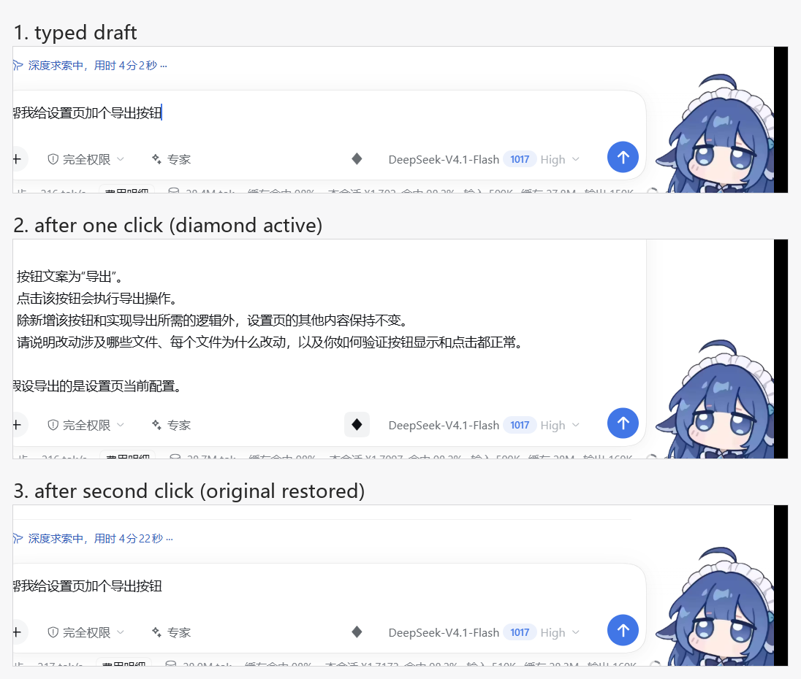
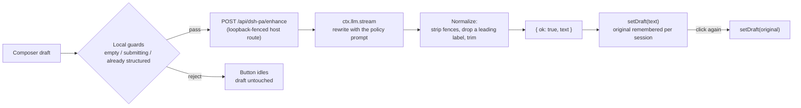

# dsh-pa [](./package.json) [](./package.json) [](https://github.com/rg2304luyue/dsh-pa) [](https://github.com/topics/dsh-plugin)

**Prompt enhancement for the [DeepSeek Harness](https://github.com/deepseek-ai) web GUI** — one
click turns a rough composer draft into a well-structured prompt: an explicit goal, the
requirements the draft only implied, and a closing output expectation. Your intent is never
changed, nothing is fabricated, and the original draft is always one click away.

English | [简体中文](./README.zh-CN.md)

---

## Why

Good agent prompts say *what to deliver*, *where it belongs*, *what must not break*, and *how
success is judged*. Most drafts say "帮我加个按钮，别搞坏别的" and leave the rest to luck.

This plugin puts a **WorkBuddy-style "enhance" diamond** in the composer tool row, immediately
left of the model selector. It sends the draft through a low-temperature rewrite pass on the
harness's own LLM service and writes the result straight back into the composer — no panel to
dismiss, no copy step. Clicking the diamond again restores the exact original text, character for
character, because the original is kept per session.

## Features

| | |
|---|---|
| ✦ **Composer button** | A small diamond in `conversation.input.right`, immediately left of the model selector — click to enhance, click again to restore |
| ↩️ **In place, reversible** | The rewrite lands in the composer itself; the original draft is stored per session and restored character for character |
| 🧯 **Structured drafts left alone** | A draft that already reads like a finished prompt (list markers **plus** an output expectation, or long prose) leaves the diamond idled instead of making a good prompt worse |
| ⚡ **Repeat clicks are free** | The last rewrite per model + draft is cached for five minutes, so a second click returns identical text without a second call |
| 🧠 **Model routing** | Config route → the session's selected model → the first configured provider, in that order |
| ⚙️ **Configurable** | Six keys in the plugin `Config`, set from your profile's user patch layer; the row is configured once when it loads, so an edit takes effect when the row reloads |
| 🛡️ **Draft safety** | While a draft is submitting, while a request is in flight, or on any failure, the composer text is never mutated by the plugin |
| 🗂 **Per-session state** | The original/enhanced pair is keyed by session, so switching sessions never restores text into the wrong composer; at most 32 pairs are kept, oldest evicted first |
| 🌐 **Two languages** | Every visible string comes from the harness locale service, with `zh` and `en` dictionaries bundled |
| ♿ **Accessible** | `aria-label`, `aria-pressed`, `aria-busy`, a polite live region for the outcome, a visible focus ring, and no animation under `prefers-reduced-motion` |
| 🔒 **Loopback-only route** | The host endpoint refuses anything that is not a same-origin call from this machine |



## How it works



The plugin is one bundle with two halves, following the dsh plugin conventions:

- **Host half** (`exports "."`, ESM, `index.js`): declares the `Config` schema (schemastery — six
  keys with ranges, defaults, and descriptions), normalizes whatever the row carries (a partial or
  hand-edited row is clamped, never rejected), and registers `GET` / `HEAD` / `POST
  /api/dsh-pa/enhance` on the shared webserver inside a `ctx.effect`. `GET` returns the two
  settings the browser half needs; `POST` resolves a route, streams the rewrite through
  `ctx.llm.stream`, and answers `{ ok, text, provider, model }`. The stream is consumed on the
  host, so the browser sees one JSON answer plus structured error codes.
- **Browser half** (`exports "./client"`, `client.js`): registers the diamond into
  `conversation.input.right` through `ctx.slots.inject`, reads the draft with the standard
  `useInput` selector hook, writes it back with the standard `inputActions.setDraft`, keeps the
  original/enhanced pair per session, and localizes every string (zh/en) through the harness
  locale service. No Harness Client package is imported; the stylesheet is injected once in
  `ctx.effect`, and every colour comes from a published theme token (`--dsw-alias-*`, the radius
  and focus-ring tokens) with a literal fallback after the comma.

## Requirements

- `dsh >= 0.2.1-rc.1 < 0.3.0-0` — the range states what has actually been exercised, not an
  open-ended promise. A mismatch means the plugin does not load; it does not load with a warning.
- Boot-verified on **`0.2.1-rc.2`** — the Electron desktop application on Windows 11, end to end:
  the loader row mounts, the route answers a real model result, the diamond renders in the live
  composer, and enhance → restore → cached re-enhance all ran in the real window.
- Node `>= 20` for the offline smoke scripts in `.tmp/`. The plugin itself has no build step.
- `@deepseek-ai/schemastery` is the plugin's only package dependency, declared in `package.json`
  for the `Config` schema. It ships with the harness, and the installed copy resolves it from the
  profile's own tree.

| | |
|---|---|
| dsh | `>= 0.2.1-rc.1 < 0.3.0-0` |
| Node | `>= 20` |
| Plugin | `0.4.2` |

## Install

```bash
npm pack --pack-destination ./dist          # -> dist/dsh-pa-0.4.2.tgz

# then, in DeepSeek Harness:
plugin_manager  action=install_bundle  target=<absolute path to ./dist/dsh-pa-0.4.2.tgz>
```

**From a Git source** — no npm package needed:

```bash
dsh plugin --profile desktop add github:rg2304luyue/dsh-pa
```

Use the profile you run: `desktop` for this Electron app, `web` for `dsh web`. The bundle declares
`dsh.bundle.patch`, so the loader adds the `dsh-pa` row by itself. Or add the market index described
below under **Discover** and install from there.

Install from the packed tarball, **not** from this folder. A profile reached through an NTFS
junction (`~/.dsh` → another drive) resolves pnpm's relative `link:` symlink against the junction
spelling, so the loader cannot find the package and reports
`cannot resolve profile bundle "dsh-pa"`; the tarball installs a real directory and works.

The bundle declares `dsh.bundle.patch`, so the loader inserts the `dsh-pa` row itself — nothing in
the profile has to be edited by hand. Reinstalling requires a version bump: installing the same
version twice answers `already-installed` instead of overwriting.

**Uninstall**

```bash
plugin_manager  action=remove_bundle  target=dsh-pa
```

Then check the profile's `package.json` for a leftover `dsh-pa` entry in `dsh.profile.bundles` (and
its dependency) and restart the GUI. A `config` entry you added in your patch layer can stay — it
is inert without the plugin row.

## Usage

Type a draft, then click the diamond left of the model selector:

1. Local guards run first. An empty draft, a draft whose phase is `submitting` or `adjudicating`, a
   draft that already looks like a finished prompt, and a runtime without `setDraft` all leave the
   button idled with a tooltip naming the reason — no request is spent.
2. While the rewrite runs the diamond pulses and is not clickable. Your draft is untouched until
   the answer arrives.
3. The answer replaces the composer text in place and the diamond turns active. A screen-reader
   announcement says how to undo.
4. Click the diamond again: the original returns character for character and the button idles.
   Click a third time: the cached result comes back in well under a second, with no model call.
5. If you edit the enhanced text by hand, the stored original is dropped — the next click
   re-enhances the new text instead of resurrecting stale content.

The plugin never submits, and it never touches attachments, the queue, or the session history.
Nothing is sent to the conversation until you press send yourself.

## Configuration

Every tunable lives in the plugin's `Config` (schemastery), so it can change without editing the
source and the setting survives plugin upgrades. The bundle already inserts the row, so add an
entry **with the same id** to your profile's user layer (`cordis.patch.yml`), which applies after
every bundle layer:

```yaml
- id: dsh-pa
  name: dsh-pa
  config:
    model: ''            # '' = follow the session's selected model
    temperature: 0
    timeoutMs: 120000
    maxDraftChars: 24000
    structuredMinChars: 800
    cacheTtlMs: 300000
```

Any key you omit keeps its default (`Config` accepts a partial object).

| Key | Default | Description |
|---|---|---|
| `model` | `''` | `provider` or `provider/model` used for the rewrite, e.g. `deepseek-official/deepseek-flash`. Empty follows the composer's current selection; when neither resolves, the host half falls back to the first configured provider |
| `temperature` | `0` | Sampling temperature, 0–2. Low values keep a repeated draft's wording and shape stable |
| `timeoutMs` | `120000` | Deadline for one rewrite, 5 s – 10 min. A timeout answers `504 ABORTED` |
| `maxDraftChars` | `24000` | Longer drafts are rejected with `413 DRAFT_TOO_LARGE` rather than truncated — truncation would change your meaning |
| `structuredMinChars` | `800` | Length at which a draft counts as a finished prompt and the diamond idles. `0` removes only the length shortcut; a draft that still carries both list markers and an output expectation stays skipped |
| `cacheTtlMs` | `300000` | How long one draft's rewrite is reused for the same model. `0` turns the cache off |

**Model routing precedence:** `Config.model` → the session's `modelSelection` projection → the
first provider and model `ctx.llm` reports. If none of them resolves a route, the endpoint answers
`503 NO_MODEL` instead of guessing.

**When a change applies:** `model`, `temperature`, `timeoutMs`, and `maxDraftChars` are read per
request, so they take effect immediately. `structuredMinChars` and `cacheTtlMs` are read by the
browser half when the button mounts (from `GET /api/dsh-pa/enhance`, the same endpoint, same
fences), so they apply to a button that mounts afterwards — a reload or a new session.

## The built-in enhancement strategy

`index.js` `SYSTEM_PROMPT` is the whole quality budget of this plugin — roughly 1,500 characters in
three tiers.

1. **Never** — answer the request, explain the rewrite, or wrap the result in a preamble, quotes,
   or a code fence; repeat the draft as an item; change meaning, scope, terms, numbers, or tone;
   invent facts, files, APIs, or acceptance criteria; rename identifiers; switch language; add
   process rules, error handling, tests, or anything else the draft did not ask for.
2. **Always** — one goal sentence naming the artifact in the draft's own words (including the
   edited target when the draft revises something already written), first even when the draft is
   itself a numbered list; then the requirements that goal line lacks, mirroring the draft's own
   order and numbering, each tracing to the draft or a direct implication of it; vague wording
   resolved into the specifics the draft implies; and one closing output requirement — the only
   item the model may add on its own initiative.
3. **Style** — plain markdown, a goal line then a list, 60–200 words and never above 250. A
   question becomes an analysis request ("why is X slow?" → "list the likely causes and how to
   verify each"), but a statement never becomes a rhetorical question. Re-runs on the same draft
   keep wording, structure, and order stable; an already precise draft gets the minimum edit. One
   ambiguity that would change the implementation (size, position, default state, persistence)
   earns a single trailing `Assuming …` / `假设 …` clause.

Sampling runs at `temperature: 0` by default, so a repeated draft keeps its structure, ordering,
and meaning — but a provider may still vary a word here and there, which is exactly why the
five-minute cache makes a repeated click return the identical answer. The strategy is deliberately
conservative: a short draft yields a short result, not a padded checklist. It is not editable in
this version; `Config` carries the call parameters, not the prompt.

## Error handling & edge cases

| Case | Behaviour |
|---|---|
| Empty / whitespace-only draft | Local refusal, `button.empty` tooltip; no request |
| Draft is `submitting` or `adjudicating` | Local refusal, `button.blocked` tooltip; no request |
| Draft already reads like a finished prompt | Local refusal, `button.structured` tooltip; no request |
| Runtime without `inputActions.setDraft` | Local refusal, `button.unsupported` tooltip |
| Draft over `maxDraftChars` | `413 DRAFT_TOO_LARGE`, rejected rather than truncated |
| Empty or invalid JSON body | `400 BAD_REQUEST` |
| Body over 512 KiB | `413 BAD_REQUEST`; the socket is destroyed, not buffered |
| No model resolvable | `503 NO_MODEL` |
| Upstream model failure | `502` with a stable code (`AUTH`, `RATE_LIMIT`, `NO_ADAPTER`, `CONTEXT_WINDOW_EXCEEDED`, …) |
| Model returns nothing usable | `502 EMPTY_RESULT`; the draft is untouched |
| Rewrite exceeds `timeoutMs` | `504 ABORTED`; the call is aborted, not left hanging |
| Anything unexpected in the handler | `500 INTERNAL`, with absolute paths redacted to `<path>` |
| Any failure at all | The composer text is never modified; the tooltip shows `error.prefix` + the host message for six seconds |

## Error codes

The endpoint answers `{ ok: false, error: { code, message } }`. The browser prefixes the localized
`error.prefix` and shows the host's `message` verbatim underneath — that line is a diagnostic, not
translated copy.

| Code | HTTP | Meaning |
|---|---|---|
| `FORBIDDEN` | 403 | Not a same-origin loopback call, or the `x-dsh-pa: 1` header is missing |
| `BAD_REQUEST` | 400 / 413 | Malformed JSON, or a body over 512 KiB |
| `EMPTY_DRAFT` | 400 | `draft` was empty after trimming |
| `DRAFT_TOO_LARGE` | 413 | Longer than `maxDraftChars` |
| `NO_MODEL` | 503 | No provider/model could be resolved |
| `AUTH` / `RATE_LIMIT` / `NO_ADAPTER` / `CONTEXT_WINDOW_EXCEEDED` / `LLM_ERROR` | 502 | Upstream provider failure, passed through |
| `EMPTY_RESULT` | 502 | The model produced no usable text |
| `ABORTED` | 504 | Exceeded `timeoutMs` |
| `INTERNAL` | 500 | Unexpected host error |
| — | 405 | Any verb other than `GET` / `HEAD` / `POST`, with `allow: GET, HEAD, POST` |

## Troubleshooting

**The diamond is missing.** Confirm `dsh-pa` is installed and enabled, then check that the loader
row exists (`cordis_inspect_query` → `Config.listConfigs` with `name: dsh-pa`). A bundle failing
its compatibility gate is skipped, not warned about — check `engines.dsh` against your harness
version.

**The diamond is grey with text in the box.** Either the draft trips the structured heuristic
(long prose, or list markers plus an output expectation) or its phase is submitting. Editing one
character re-enables it; `structuredMinChars: 0` keeps only the list-plus-output check.

**"Enhancement failed: …" with `NO_MODEL`.** Nothing resolved a route: fill `model` in the config,
select a model in the composer, or make sure at least one provider is configured.

**"Enhancement failed: …" with `AUTH` / `RATE_LIMIT`.** That is the provider's credential or quota,
not the plugin — check the harness credential store, then retry.

**Nothing happens on click.** The button needs `inputActions.setDraft` from the composer; on a
harness build that no longer provides it the tooltip says `button.unsupported`.

**A rewrite feels slow.** Each enhancement is one billable model call; under a busy session it can
take tens of seconds. `timeoutMs` bounds it, and a repeat click is instant from the cache.

## Security model

The endpoint is served by your own dsh host and reachable **only from this machine**:

- **Socket fence** — requests whose peer address is not loopback (`127.0.0.1` / `::1` /
  `::ffff:127.*`) are refused. Any local process can still call the route; there is no per-user
  authentication.
- **Header fence** — `x-dsh-pa: 1` is required, so an unrelated page cannot spend your quota with a
  drive-by `fetch` or a plain form post.
- **Origin / site fence** — `sec-fetch-site` must be absent or `same-origin`, and a present
  `origin` must be loopback **and** match the `Host` header, which defeats DNS rebinding.
- **Body cap** — 512 KiB, enforced while reading, with the socket destroyed on overflow.
- **No-store** — every response carries `cache-control: no-store`.
- **Prompt boundary** — the draft is framed inside `<draft>` tags in the user message and the
  system prompt treats the framed text as data. Prompt-level boundaries are best-effort, not a
  guarantee.
- **Data path** — browser → your own host → `ctx.llm` → the provider your harness is configured
  with. Nothing goes anywhere else, and an enhancement never enters the conversation history.

## Files

```
package.json        manifest: bundle patch, client injection, dsh compatibility ranges,
                    one dependency (@deepseek-ai/schemastery) for the Config schema
cordis.patch.yml    one insert row (id: dsh-pa) carrying config: {}
index.js            host half: schema + apply(ctx, config), same-origin endpoint,
                    model resolution, streaming rewrite
client.js           client half: toolbar diamond, per-session original/enhanced pairs,
                    config fetch, structured-draft gate, five-minute result cache
locale/en.json      meta.title / meta.description for dshmarket
locale/zh.json      Chinese market copy
icon.svg            original icon (691 B)
docs/market/index.json  format-1 market index, served by GitHub Pages
README.md           this file
README.zh-CN.md     the same document in Simplified Chinese
LICENSE             MIT
docs/*.png          evidence screenshots embedded above
docs/market/icon.svg  the icon the index resolves next to itself
.tmp/               offline smoke scripts and window-capture helpers (never packed)
node_modules/       local copies so the smoke scripts can import index.js (never packed)
```

Not shipped: `.tmp/`, `node_modules/`, `market/`, `docs/`. The tarball contains exactly ten files:
`package.json`, `index.js`, `client.js`, `cordis.patch.yml`, `locale/en.json`, `locale/zh.json`,
`icon.svg`, `README.md`, `README.zh-CN.md`, `LICENSE`.

## Conflict avoidance

| Surface | Ownership |
|---|---|
| Slot entry | `conversation.input.right` / id `dsh-pa/enhance` / order `40` — appends to a list, never replaces a seat |
| HTTP route | `GET` / `HEAD` / `POST /api/dsh-pa/enhance` — loopback-only, same-origin, `x-dsh-pa: 1` required |
| Config row | only the `dsh-pa` row's own `config`; no other plugin's config is read or written |
| Locale namespace | `dsh-pa` |
| Style element | `style[data-plugin="dsh-pa"]`, every class name prefixed `dsh-pa-` |
| Theme tokens | colour, radius, and focus ring come from published `--dsw-*` tokens, each with a literal fallback; no harness CSS class is reused |
| Dependencies | no other plugin depends on this one, and this one depends on no other plugin (its single package dependency is `@deepseek-ai/schemastery`, for the `Config` schema) |

## Market index

`docs/market/index.json` is a format-1 index for this bundle, meant to be served by GitHub Pages
straight out of this repository. `docs/market/icon.svg` sits beside it, so the relative `icon`
resolves to `https://rg2304luyue.github.io/dsh-pa/market/icon.svg`.

The single version installs from Git, pinned to a commit, so no npm package is involved:

```json
"source": { "type": "git", "url": "https://github.com/rg2304luyue/dsh-pa", "commit": "<40-hex>" }
```

Checked against the harness's own validator (`@deepseek-ai/dsh-plugin-market-index`):
`parseMarketIndex` accepts the document, and `marketInstallTarget` returns
`git+https://github.com/rg2304luyue/dsh-pa.git#<commit>`.

Enable **Settings → Pages → Deploy from a branch → `main` / `/docs`**, then add
`https://rg2304luyue.github.io/dsh-pa/market/index.json` in **插件市场 → 发现 → 添加索引源**. The
market takes only canonical `http:`/`https:` URLs and follows no redirects, so serve the file at its
final address.

A pinned commit means every release needs two pushes: bump `package.json` and push, then write the
new commit SHA and `publishTimestamp` into `docs/market/index.json` and push again. A stale pin keeps
installing the older code, silently. There is also no upgrade path in the market: remove, then install.

## Awesome list entry

`market/awesome/rg2304luyue__dsh-pa.yml` is the entry for
[`awesome-dsh-plugin`](https://github.com/awesome-dsh-plugin/awesome-dsh-plugin). The pull request adds
that single file as `data/plugins/rg2304luyue__dsh-pa.yml` — the READMEs there are generated, so nothing
else is touched. Filename, `url`, and `name` all derive from the repository
([rg2304luyue/dsh-pa](https://github.com/rg2304luyue/dsh-pa)), so renaming the repository means renaming
all three.

- `category: ui` — the diamond is a composer control, so it belongs under UI Enhancements.
- No `icon:` — that list accepts only GitHub-hosted raster images (`png`/`jpg`/`webp`) and otherwise
  falls back to the owner's avatar. This bundle's `icon.svg` is for dshmarket, which takes SVG; the
  awesome list refuses it, so the entry omits the field instead of pointing at a file it would reject.
- No `tarball:` — the repository installs from source: `dsh.bundle.patch` plus a `cordis.patch.yml`
  beside it, and a `dsh-plugin topic`, with no build step. A Release `.tgz` would only be required if
  the source could not be installed at all.
- `screenshots.json` at the repository root lists `docs/verification.png` and
  `docs/verification-shortcuts.png`; paths are relative to that file, which is how storefronts read them.
- `@deepseek-ai/schemastery` sits in `peerDependencies`, not `dependencies`, following the list's advice
  for official `@deepseek-ai/*` packages. The plugin still loads: `Config.listConfigs` reports the row as
  `schema` with all six keys on the installed copy.
- Two requirements live in the repository rather than the entry: the repository must be at least one day
  old, and it must carry the `dsh-plugin` topic.

## Development

There is no build step: the host half is plain ESM, and the browser half is a single
`window.__ModuleLoader__.load({ id, factory })` script.

```bash
node --check index.js                  # host half parses
node --check client.js                 # browser half parses
node .tmp/smoke-host.mjs               # route: verbs, fences, limits, config clamping   -> HOST_SMOKE_OK
node .tmp/smoke-client.cjs             # component: guards, labels, cache, config fetch -> CLIENT_SMOKE_OK
npm pack --pack-destination .tmp/dist  # then install the tarball (a version bump is required)
```

The smoke scripts fake the webserver, the request/response pair, the LLM stream, React, and the
slot registry, so they run with no harness attached — they are the only automated coverage.
Behaviour inside the real renderer was checked by driving the application window and sampling the
button's rendered pixels, which is why `docs/` carries screenshots. Release loop: bump
`package.json` (and the version strings here, in `README.zh-CN.md`, and in `docs/market/index.json`),
`npm pack`, install the tarball, re-run both smoke scripts, then re-check one live enhance.

## FAQ

**Why does a second click restore instead of enhancing again?** The pair is stored per session:
while the composer still holds the enhanced text, the click means "undo". Editing the text drops
the pair, so the next click enhances what you have now.

**Why is a long draft refused?** Truncation would silently change your meaning. Raise
`maxDraftChars` instead.

**Why was a good prompt skipped instead of improved?** The structured-draft guard exists to avoid
making a finished prompt worse. Set `structuredMinChars: 0` if you disagree with the length part.

**Does it work with any provider?** Yes — it rides `ctx.llm`, so whatever the harness serves
(DeepSeek official, OpenAI-compatible gateways) works, including the session's own selection.

**Does it touch my history or attachments?** No. Only the composer draft text is read and written;
attachments, the queue, and the session log are untouched.

## Manual smoke checklist

After installing and (if the loader asks) restarting:

1. `Config.listConfigs` shows the `dsh-pa` row with `status: schema` and six described keys.
2. The diamond renders immediately left of the model selector; it is dimmed with an empty draft.
3. Type a short conversational draft → click the diamond → it becomes a goal line plus a short
   list, and the diamond turns active.
4. Click again → the exact original text returns and the diamond idles.
5. Click once more → the identical enhancement returns in well under a second (cache hit, no call).
6. Paste a draft that already has numbered items plus an output requirement → the diamond stays
   dimmed and a click changes nothing.
7. `curl -H "x-dsh-pa: 1" http://127.0.0.1:<port>/api/dsh-pa/enhance` → `{ ok: true, config }`;
   without the header → `403`; `PUT` → `405` with `allow: GET, HEAD, POST`.

## Verified on

DeepSeek Harness `0.2.1-rc.2` (Electron, Windows 11), profile `desktop`:

- The loader row `dsh-pa` mounts, and the live client registers `dsh-pa/enhance` into
  `conversation.input.right` (order 40) — confirmed through the client `Slots` inspector.
- The button renders left of the model control, dimmed with an empty draft.
- Clicking with a draft replaces it with a rule-shaped prompt (`deepseek-official` /
  `deepseek-flash`, from a localised short draft); clicking again restores the exact original text
  and the idle state.
- Guard checks: no `x-dsh-pa` header → `403 FORBIDDEN`; empty draft → `400 EMPTY_DRAFT`.
- A structured draft leaves the diamond dimmed and a click changes nothing
  (`docs/verification-shortcuts.png`); pressing the same draft again after a restore returns the
  identical text in under half a second.
- `Config` is live: the loader reports the row as `schema` with all six keys, defaults, ranges, and
  descriptions, which also proves the declared `@deepseek-ai/schemastery` dependency resolves on
  the installed copy.
- `GET /api/dsh-pa/enhance` returns `{ ok: true, config: { structuredMinChars, cacheTtlMs } }`; the
  route answers `405` with `allow: GET, HEAD, POST` for other verbs and `403` without the header.

## Acknowledgments

The README structure — Why / Features / How it works / Requirements / Install / Usage /
Configuration / strategy / errors / troubleshooting / security / files / development / FAQ / smoke
checklist — follows a published dsh plugin,
[`rongxingda/dsh-prompt-enhance`](https://github.com/rongxingda/dsh-prompt-enhance): the same
feature domain, the same `conversation.input.right` seat, installable from npm and listed in the
market, which makes its documentation the closest thing to a house style for this kind of plugin.
The plugin conventions themselves — bundle patch layer, `Config` schema, locale service, slot
contribution — come from the harness's own `cordis-plugin-development` guide.

## License

MIT — see [LICENSE](./LICENSE).
