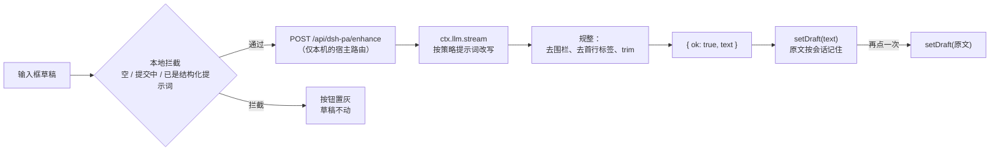

# dsh-pa [](./package.json) [](./package.json) [](https://github.com/rg2304luyue/dsh-pa) [](https://github.com/topics/dsh-plugin)

**DeepSeek Harness Web 界面的提示词增强插件** —— 点一下，把输入框里随口写的草稿变成结构清楚的
提示词：明确的目标、草稿隐含的要求、收尾的输出预期。原意不变、不无中生有，原始草稿永远一键可回。

[English](./README.md) | 简体中文

---

## 为什么

好的 agent 提示词会说清楚 *交付什么*、*放在哪里*、*什么不能弄坏*、*怎么算做对*。多数草稿只写
"帮我加个按钮，别搞坏别的"，其余靠运气。

本插件在输入框工具栏里、模型选择器左侧放一个 **WorkBuddy 风格的"增强"菱形**：把草稿交给
harness 自己的 LLM 服务做一次低温改写，结果**直接写回输入框**——没有预览面板、没有复制粘贴。
再点一次菱形，逐字恢复原始草稿，因为原文按会话保存着。

## 功能

| | |
|---|---|
| ✦ **输入框按钮** | 菱形位于 `conversation.input.right`，紧挨模型选择器左侧；点击增强，再点还原 |
| ↩️ **就地、可逆** | 改写结果落在输入框本身；原文按会话保存，逐字恢复 |
| 🧯 **结构化草稿不动手** | 已像成品提示词的草稿（列表标记 **加** 输出预期，或篇幅很长）只让菱形置灰，不会把好提示词改坏 |
| ⚡ **连点不花钱** | 同一模型 + 同一草稿的结果缓存五分钟，第二次点击返回完全相同的文本，不再调用模型 |
| 🧠 **模型路由** | 配置路由 → 当前会话选中的模型 → 第一个已配置的 provider，依次尝试 |
| ⚙️ **可配置** | 插件 `Config` 六个键，写在用户 patch 层；配置在行加载时读取一次，改完要等该行重新加载才生效 |
| 🛡️ **草稿安全** | 提交中、请求进行中、以及任何失败情况下，插件都不会改动输入框文本 |
| 🗂️ **按会话记忆** | 每个会话各自保存最近 32 对原文/增强文，切换会话互不串扰 |
| 🌐 **双语界面** | 按钮提示与状态文案走 harness locale 服务，中/英自动跟随界面语言 |
| ♿ **可访问** | 按钮带 `aria-label`/`aria-pressed`/`aria-busy`，状态经 `role="status"` 播报，有可见焦点环，并尊重系统「减少动态效果」 |
| 🔒 **仅本机路由** | 宿主端点拒绝一切非同源、非本机的调用 |


## 工作原理



插件是一个 bundle、两个半边，遵循 dsh 插件约定：

- **宿主半边**（`exports "."`，ESM，`index.js`）：声明 `Config` schema（手写的 standard-schema
  `~standard` 校验器，六个键都带范围、默认值、描述），对行里传来的配置做归一化（缺键或手改过的值被钳制，
  而不是报错），并在 `ctx.effect` 内于共享 webserver 注册 `GET | HEAD | POST /api/dsh-pa/enhance`。`GET`
  返回浏览器半边需要的两个设置；`POST` 解析路由、用 `ctx.llm.stream` 流式改写，最终回 `{ ok, text,
  provider, model }`。流在宿主侧消费完毕，浏览器只拿到一个 JSON 答复和结构化错误码。
- **浏览器半边**（`exports "./client"`，`client.js`）：通过 `ctx.slots.inject` 把菱形注册进
  `conversation.input.right`，用标准 `useInput` selector hook 读草稿、用标准
  `inputActions.setDraft` 写回，按会话保存原文/增强文对，所有文案（中/英）走 harness locale 服务。
  不 import 任何 Harness Client 包；样式表在 `ctx.effect` 里注入一次，颜色、圆角、焦点环都取自公开的
  `--dsw-*` token，每个 token 后面跟一个字面 fallback。

## 环境要求

- `dsh >= 0.2.1-rc.1 < 0.3.0-0` —— 这个范围代表**实际验证过**的版本，不是无限期的承诺。版本不匹配意味着
  插件**不会加载**，而不是加载后给个警告。
- 已在 **`0.2.1-rc.2`** 上端到端验证 —— Windows 11 的 Electron 桌面应用：加载器行挂载、路由返回真实
  模型结果、菱形在真实输入框里渲染，增强 → 还原 → 缓存再增强都在真窗口里跑通。
- Node `>= 20`，供 `.tmp/` 下的离线冒烟脚本使用；插件本身没有构建步骤。
- **没有任何包依赖。** `Config` 校验器是照 standard-schema 接口手写的，所以不需要从 profile 的依赖树里
  解析任何东西：被 pnpm 剪枝过的 profile 和全新 profile 加载它的表现完全一致。

| | |
|---|---|
| dsh | `>= 0.2.1-rc.1 < 0.3.0-0` |
| Node | `>= 20` |
| 插件 | `0.4.3` |

## 安装

```bash
npm pack --pack-destination ./dist          # -> dist/dsh-pa-0.4.3.tgz

# 然后在 DeepSeek Harness 里：
plugin_manager  action=install_bundle  target=<./dist/dsh-pa-0.4.3.tgz 的绝对路径>
```

**从 Git 源安装**（不需要 npm 包）：

```bash
dsh plugin --profile desktop add github:rg2304luyue/dsh-pa
```

profile 名按你实际运行的来：这个 Electron 应用是 `desktop`，`dsh web` 是 `web`。bundle 声明了
`dsh.bundle.patch`，加载器会自己加 `dsh-pa` 行。也可以在**发现**里添加下文的索引源，从那里安装。

请用打好的 tarball 安装，**不要**直接指向本目录。若 profile 位于 NTFS junction 之下（`~/.dsh` 指向
另一块盘），pnpm 建出的相对 `link:` 软链会被按 junction 拼写解析，加载器找不到包并报
`cannot resolve profile bundle "dsh-pa"`；安装 tarball 得到的是真实目录，可用。

bundle 声明了 `dsh.bundle.patch`，加载器会自己插入 `dsh-pa` 行——profile 不需要手工编辑。重复安装需要
先升版本：同版本再装会返回 `already-installed`，不会覆盖。

**卸载**

```bash
plugin_manager  action=remove_bundle  target=dsh-pa
```

随后检查 profile 的 `package.json` 里 `dsh.profile.bundles` 是否残留 `dsh-pa` 行（以及对应依赖），
重启界面。你在 patch 层添加的 `config` 可以留着——没有插件行时它是惰性的。

## 使用

输入草稿，点击模型选择器左侧的菱形：

1. 先跑本地拦截。空草稿、`phase` 为 `submitting` / `adjudicating` 的草稿、已经像成品提示词的草稿、
   以及当前运行时拿不到 `setDraft` 的情况，都只让按钮置灰并在 tooltip 里说明原因——不消耗请求。
2. 改写期间菱形脉动且不可点；结果到达之前你的草稿不会被改动。
3. 答案就地替换输入框文本，菱形转为激活态；读屏会播报如何撤销。
4. 再点一次：原文逐字回来，按钮回置灰态。第三次点击：缓存结果立刻出现（不到一秒），不调用模型。
5. 如果你手工编辑了增强后的文本，保存的原文会被丢弃——下次点击增强当前文本，而不是把旧内容复活。

插件从不提交消息，也不碰附件、队列与会话历史。在你亲自按下发送之前，什么都不会进入对话。

## 配置

所有可调值都在插件的 `Config`（手写 `~standard` schema）里，无需改源码，配置可跨插件升级存活。bundle
已经插入了该行，所以请在你 profile 的**用户层**（`cordis.patch.yml`，在所有 bundle 层之后生效）追加一条
**同 id** 的条目：

```yaml
- id: dsh-pa
  name: dsh-pa
  config:
    model: ''            # '' = 跟随当前会话选中的模型
    temperature: 0
    timeoutMs: 120000
    maxDraftChars: 24000
    structuredMinChars: 800
    cacheTtlMs: 300000
```

省略的键保留默认值（`Config` 接受部分对象）。

| 键 | 默认值 | 说明 |
|---|---|---|
| `model` | `''` | 用于改写的 `provider` 或 `provider/model`，如 `deepseek-official/deepseek-flash`。留空则跟随输入框当前选择；两者都解析不到时，宿主半边退回第一个已配置的 provider |
| `temperature` | `0` | 采样温度，0–2。低值让同一草稿重复改写时措辞与结构更稳 |
| `timeoutMs` | `120000` | 单次改写时限，5 秒 – 10 分钟。超时回 `504 ABORTED` |
| `maxDraftChars` | `24000` | 更长的草稿直接以 `413 DRAFT_TOO_LARGE` 拒绝，而不是截断——截断会改变你的原意 |
| `structuredMinChars` | `800` | 达到该长度即视为成品提示词、菱形置灰。设为 `0` 只关掉这个长度捷径；带列表标记 **且** 带输出预期的草稿仍会被跳过 |
| `cacheTtlMs` | `300000` | 同一模型下复用同一草稿改写的时长。`0` 关闭缓存 |

**模型路由优先级：** `Config.model` → 会话的 `modelSelection` 投影 → `ctx.llm` 报告的第一个 provider 与
模型。三者都解析不到时，端点直接回 `503 NO_MODEL`，不做猜测。

**何时生效：** `model`、`temperature`、`timeoutMs`、`maxDraftChars` 每次请求读取，改动立即生效；
`structuredMinChars` 与 `cacheTtlMs` 由浏览器半边在按钮挂载时从 `GET /api/dsh-pa/enhance`（同一端点、
同一套校验）读取，因此对之后挂载的按钮生效——刷新或新会话。

## 内置改写策略

`index.js` 的 `SYSTEM_PROMPT` 就是这个插件的全部质量预算，约 1500 字符，分三档。

1. **永不做** —— 回答请求、解释改写、用前言/引号/代码围栏包裹结果；把草稿复述成条目；改变含义、
   范围、术语、数字或语气；编造事实、文件、API 或验收标准；重命名标识符；切换语言；添加草稿没有要求的
   流程规则、错误处理、测试或任何其它内容。
2. **总是做** —— 先写一句目标，用草稿自己的措辞点明交付物（当草稿是在改既有内容时，点明被改对象），
   即使草稿本身是编号列表也必须放在最前；然后补上目标句缺少的要求，沿用草稿自身的顺序与编号，每一条
   都能追溯到草稿原文或它的直接含义；把含糊措辞落实成草稿隐含的具体条件；最后给一条收尾的输出要求——
   这是唯一允许模型主动添加的条目。
3. **风格** —— 纯 markdown，目标句 + 列表，60–200 词、上限 250。问句可转成分析请求（"为什么 X 慢？"
   → "列出可能原因以及各自的验证方法"），但陈述句不得改成反问。同一草稿重跑时措辞、结构、顺序保持
   稳定；已经精确的草稿只做最小改动。只有当某处歧义会影响实现（尺寸、位置、默认状态、持久化）时，
   才在结尾加一句 `假设 …` / `Assuming …`。

默认 `temperature: 0`，重复改写同一草稿时结构、顺序、语义保持一致；但 provider 仍可能换个词，这正是
五分钟缓存存在的理由——它让重复点击返回**完全相同**的文本。策略刻意保守：短草稿得到短结果，而不是
被塞成一份清单。本版本不支持自定义策略，`Config` 管的是调用参数，不是提示词。

## 异常与边界

| 情况 | 行为 |
|---|---|
| 空 / 纯空白草稿 | 本地拒绝，`button.empty` tooltip；不发请求 |
| 草稿处于 `submitting` / `adjudicating` | 本地拒绝，`button.blocked` tooltip；不发请求 |
| 草稿已像成品提示词 | 本地拒绝，`button.structured` tooltip；不发请求 |
| 运行时没有 `inputActions.setDraft` | 本地拒绝，`button.unsupported` tooltip |
| 超过 `maxDraftChars` | `413 DRAFT_TOO_LARGE`，拒绝而非截断 |
| 请求体为空或 JSON 非法 | `400 BAD_REQUEST` |
| 请求体超过 512 KiB | `413 BAD_REQUEST`；直接销毁 socket，不继续缓冲 |
| 解析不到模型 | `503 NO_MODEL` |
| 上游模型失败 | `502`，附带稳定错误码（`AUTH`、`RATE_LIMIT`、`NO_ADAPTER`、`CONTEXT_WINDOW_EXCEEDED` 等） |
| 模型没有返回可用文本 | `502 EMPTY_RESULT`；草稿不动 |
| 超过 `timeoutMs` | `504 ABORTED`；调用被中止，不会挂着 |
| 处理函数里的意外错误 | `500 INTERNAL`，绝对路径脱敏成 `<path>` |
| 任何失败 | 输入框文本一律不改；tooltip 显示 `error.prefix` + 宿主消息，六秒后自动消失 |

## 错误码

端点返回 `{ ok: false, error: { code, message } }`。浏览器半边给 `message` 加上已本地化的
`error.prefix` 作为前缀，下面原样显示宿主消息——那一行是诊断信息，不做翻译。

| 错误码 | HTTP | 含义 |
|---|---|---|
| `FORBIDDEN` | 403 | 非同源本机调用，或缺少 `x-dsh-pa: 1` 头 |
| `BAD_REQUEST` | 400 / 413 | JSON 非法，或请求体超过 512 KiB |
| `EMPTY_DRAFT` | 400 | 去空白后 `draft` 为空 |
| `DRAFT_TOO_LARGE` | 413 | 超过 `maxDraftChars` |
| `NO_MODEL` | 503 | 解析不到任何 provider/model |
| `AUTH` / `RATE_LIMIT` / `NO_ADAPTER` / `CONTEXT_WINDOW_EXCEEDED` / `LLM_ERROR` | 502 | 上游 provider 失败，原样透出 |
| `EMPTY_RESULT` | 502 | 模型没有产出可用文本 |
| `ABORTED` | 504 | 超过 `timeoutMs` |
| `INTERNAL` | 500 | 宿主侧意外错误 |
| — | 405 | `GET` / `HEAD` / `POST` 之外的动词，响应带 `allow: GET, HEAD, POST` |

## 排错

**菱形不见了。** 先确认 `dsh-pa` 已安装并启用，再用 `cordis_inspect_query` → `Config.listConfigs`
（`name: dsh-pa`）确认加载器行存在。未通过兼容性门禁的 bundle 会被静默跳过，请核对
`engines.dsh` 与你的 harness 版本。

**输入框里有字，菱形却是灰的。** 要么草稿触发了结构化判定（长文本，或列表标记加输出预期），要么草稿
正在提交。改一个字即可重新启用；把 `structuredMinChars` 设为 `0` 只保留"列表 + 输出预期"这一条判定。

**"增强失败：…" 且带 `NO_MODEL`。** 没有任何路由被解析出来：在配置里填 `model`，或在输入框里选一个
模型，或确认至少配置了一个 provider。

**"增强失败：…" 且带 `AUTH` / `RATE_LIMIT`。** 这是 provider 的凭据或额度问题，不是插件——检查
harness 凭据存储后重试。

**点了没反应。** 按钮需要输入框提供的 `inputActions.setDraft`；在不提供它的 harness 版本上，tooltip 会
显示 `button.unsupported`。

**改写很慢。** 每次增强都是一次计费的模型调用，会话繁忙时可能几十秒。`timeoutMs` 会兜住上限，而重复
点击走缓存，是瞬时的。

## 安全模型

端点由你自己的 dsh 宿主提供，**只对本机可达**：

- **socket 围栏** —— 对端地址不是环回（`127.0.0.1` / `::1` / `::ffff:127.*`）一律拒绝。注意任何本机进程
  仍可调用该路由；它没有按用户鉴权。
- **请求头围栏** —— 必须带 `x-dsh-pa: 1`，无关页面的一次随手 `fetch` 或一个普通表单 POST 无法消耗你的额度。
- **Origin / Site 围栏** —— `sec-fetch-site` 必须缺省或为 `same-origin`；带 `origin` 时必须是环回地址
  **且** 与 `Host` 头一致，这同时挡掉了 DNS rebinding。
- **请求体上限** —— 512 KiB，边读边判，超限直接销毁 socket。
- **不缓存** —— 所有响应都带 `cache-control: no-store`。
- **提示词边界** —— 草稿被 `<draft>` 标签包住作为用户消息内容，系统提示词把这段文本当作数据。提示词级
  边界是尽力而为，不是保证。
- **数据路径** —— 浏览器 → 你自己的宿主 → `ctx.llm` → harness 配置的 provider。不经过任何第三方，增强结果
  也从不进入对话历史。

## 文件

```
package.json        manifest：bundle patch、client 注入、dsh 兼容范围、
                    没有任何包依赖（Config 校验器是手写的）
cordis.patch.yml    一条 insert 行（id: dsh-pa），携带 config: {}
index.js            宿主半边：schema + apply(ctx, config)、同源端点、模型解析、流式改写
client.js           浏览器半边：工具栏菱形、按会话保存的原文/增强文对、配置拉取、
                    结构化草稿闸门、五分钟结果缓存
locale/en.json      dshmarket 用的 meta.title / meta.description
locale/zh.json      中文市场文案
icon.svg            原创图标（691 B）
docs/market/index.json  format-1 市场索引（由 GitHub Pages 提供）
README.md           英文主文档
README.zh-CN.md     本文档
LICENSE             MIT
docs/*.png          上文嵌入的证据截图
docs/market/icon.svg  索引同目录下的图标
.tmp/               离线冒烟脚本与窗口截图辅助脚本（永不打包）
node_modules/       供冒烟脚本 import index.js 的本地副本（永不打包）
```

不打包：`.tmp/`、`node_modules/`、`market/`、`docs/`。tarball 里正好十个文件：`package.json`、
`index.js`、`client.js`、`cordis.patch.yml`、`locale/en.json`、`locale/zh.json`、`icon.svg`、
`README.md`、`README.zh-CN.md`、`LICENSE`。

## 冲突规避

| 面 | 归属 |
|---|---|
| Slot 条目 | `conversation.input.right` / id `dsh-pa/enhance` / order `40` —— 追加到列表，从不替换既有座位 |
| HTTP 路由 | `GET` / `HEAD` / `POST /api/dsh-pa/enhance` —— 仅本机、同源、必须带 `x-dsh-pa: 1` |
| 配置行 | 只读写 `dsh-pa` 这一行自己的 `config`，不碰其它插件的配置 |
| Locale 命名空间 | `dsh-pa` |
| 样式元素 | `style[data-plugin="dsh-pa"]`，所有类名以 `dsh-pa-` 为前缀 |
| 主题 token | 颜色、圆角、焦点环取自公开的 `--dsw-*` token，每个都带字面 fallback；不复用 harness 的 CSS 类 |
| 依赖关系 | 没有其它插件依赖本插件；本插件也不依赖任何其它插件 —— 包本身不声明任何依赖 |

## 市场索引

`docs/market/index.json` 是本 bundle 的 format-1 索引，用 GitHub Pages 直接从本仓库发布。`docs/market/icon.svg`
与它同目录，所以相对的 `icon` 解析成 `https://rg2304luyue.github.io/dsh-pa/market/icon.svg`。

唯一一个版本走 Git 源并钉住 commit，不需要 npm 包：

```json
"source": { "type": "git", "url": "https://github.com/rg2304luyue/dsh-pa", "commit": "<40 位十六进制>" }
```

已用 harness 自带的校验器（`@deepseek-ai/dsh-plugin-market-index`）核对：`parseMarketIndex` 接受该文档，
`marketInstallTarget` 返回 `git+https://github.com/rg2304luyue/dsh-pa.git#<commit>`。

打开 **Settings → Pages → Deploy from a branch → `main` / `/docs`**，然后在**插件市场 → 发现 → 添加索引源**
里填 `https://rg2304luyue.github.io/dsh-pa/market/index.json`。市场只接受规范的 `http:`/`https:` 地址，且
不跟随重定向，所以索引必须直接可访问。

钉 commit 意味着每次发版要推两次：先升 `package.json` 并推送，再把新的 commit SHA 与 `publishTimestamp`
写进 `docs/market/index.json` 再推一次。钉住的 commit 过期时，市场会静默安装旧代码。另外市场没有升级通道：
只能先卸载再安装。

## 收录条目（awesome-dsh-plugin）

`market/awesome/rg2304luyue__dsh-pa.yml` 是给
[`awesome-dsh-plugin`](https://github.com/awesome-dsh-plugin/awesome-dsh-plugin) 的条目。PR 只需把这一个文件
以 `data/plugins/rg2304luyue__dsh-pa.yml` 的名字加进去——那边的两个 README 是生成的，别的一概不动。文件名、
`url`、`name` 三者都取自仓库（[rg2304luyue/dsh-pa](https://github.com/rg2304luyue/dsh-pa)），所以改仓库名
就要同时改这三处。

- `category: ui` —— 菱形是输入框控件，归 UI 增强。
- 不写 `icon:` —— 该列表只接受 GitHub 托管的位图（`png`/`jpg`/`webp`），不写则回退作者头像。本 bundle 的
  `icon.svg` 是给 dshmarket 用的（那边接受 SVG），该列表明确拒绝 SVG，所以条目里干脆不填，而不是指一个
  会被拒的文件。
- 不写 `tarball:` —— 仓库可从源码安装：`dsh.bundle.patch` + 同级 `cordis.patch.yml`、`dsh-plugin` topic，
  没有构建步骤；只有「根本无法从源码安装」时才必须挂 Release `.tgz`。
- 仓库根的 `screenshots.json` 列出 `docs/verification.png` 与 `docs/verification-shortcuts.png`，路径相对
  该文件本身，市场按此读取。
- 包不声明任何依赖，也不声明 peer 依赖，所以条目里不需要「安装顺序」这类附加说明：`Config` 校验器是
  手写的，插件加载不依赖 profile 树里的任何东西。
- 另有两项属于仓库而非条目：仓库需创建满一天，并打上 `dsh-plugin` topic。

## 开发

没有构建步骤：宿主半边是纯 ESM，浏览器半边是单个 `window.__ModuleLoader__.load({ id, factory })` 脚本。

```bash
node --check index.js                  # 宿主半边语法
node --check client.js                 # 浏览器半边语法
node .tmp/smoke-host.mjs               # 路由：动词、围栏、上限、配置钳制   -> HOST_SMOKE_OK
node .tmp/smoke-client.cjs             # 组件：闸门、文案、缓存、配置拉取   -> CLIENT_SMOKE_OK
npm pack --pack-destination .tmp/dist  # 然后安装 tarball（必须先升版本）
```

冒烟脚本伪造了 webserver、请求/响应对、LLM 流、React 与 slot 注册表，因此脱离 harness 也能跑——它们是
唯一的自动化覆盖。真实渲染器里的行为是靠驱动应用窗口、采样按钮渲染像素来确认的，这也是 `docs/` 里有
截图的原因。发版流程：升 `package.json`（以及本文、`README.md`、`docs/market/index.json` 里的版本号）→
`npm pack` → 安装 tarball → 重跑两个冒烟脚本 → 在真窗口里再验一次增强。

## 常见问题

**为什么第二次点击是还原而不是再增强一次？** 原文/增强文对按会话保存：输入框里还是增强后的文本时，
点击就等于"撤销"。改动文本会丢弃这个对，下一次点击增强你现在的文本。

**为什么长草稿被拒绝？** 截断会悄悄改变你的原意。调高 `maxDraftChars` 即可。

**为什么好提示词被跳过而不是被优化？** 结构化闸门就是为了不把成品提示词改坏。如果你不认同其中的长度
判定，把 `structuredMinChars` 设为 `0`。

**任何 provider 都能用吗？** 能——它走 `ctx.llm`，harness 支持的（DeepSeek 官方、OpenAI 兼容网关）都能用，
也包括会话自己的选择。

**会动我的历史或附件吗？** 不会。只读写输入框草稿文本；附件、队列、会话日志都不碰。

## 手工验收清单

安装并（若加载器要求）重启后：

1. `Config.listConfigs` 里能看到 `dsh-pa` 行，`status: schema`，六个键都带描述。
2. 菱形渲染在模型选择器左侧；空草稿时置灰。
3. 输入一句口语草稿 → 点击菱形 → 变成目标句 + 短列表，菱形转为激活态。
4. 再点一次 → 原文逐字回来，菱形回置灰态。
5. 第三次点击 → 不到一秒返回完全相同的增强文本（命中缓存，无模型调用）。
6. 贴入一个已带编号条目与输出要求的草稿 → 菱形保持置灰，点击无反应。
7. `curl -H "x-dsh-pa: 1" http://127.0.0.1:<端口>/api/dsh-pa/enhance` → `{ ok: true, config }`；
   不带头 → `403`；`PUT` → `405` 且带 `allow: GET, HEAD, POST`。

## 验证环境

DeepSeek Harness `0.2.1-rc.2`（Electron，Windows 11），profile `desktop`：

- 加载器行 `dsh-pa` 成功挂载，活客户端把 `dsh-pa/enhance` 注册进 `conversation.input.right`（order 40）
  ——通过客户端 `Slots` inspector 确认。
- 按钮渲染在模型控件左侧，空草稿时置灰。
- 带草稿点击后替换为规则化的提示词（`deepseek-official` / `deepseek-flash`）；再点一次恢复原文
  并回到置灰态。
- 守卫实测：不带 `x-dsh-pa` 头 → `403 FORBIDDEN`；空草稿 → `400 EMPTY_DRAFT`。
- 结构化草稿让菱形置灰、点击无反应（见 `docs/verification-shortcuts.png`）；还原后对同一草稿再点，
  不到一秒返回完全相同的文本。
- `Config` 是活的：该行被接受并钳制（`GET` 返回实际生效的值）；schema 不需要任何库 ——
  `Config.listConfigs` 把它报为 `unsupported`，正是因为这里的 `Config` 是手写 `~standard` schema
  而不是 schemastery schema，这就是「零包依赖」的代价。
- `GET /api/dsh-pa/enhance` 返回 `{ ok: true, config: { structuredMinChars, cacheTtlMs } }`；其它动词得到
  `405` 与 `allow: GET, HEAD, POST`，不带头得到 `403`。

## 致谢

本 README 的结构——为什么 / 功能 / 工作原理 / 环境要求 / 安装 / 使用 / 配置 / 策略 / 异常 / 排错 / 安全 /
文件 / 开发 / 常见问题 / 验收清单——参照了一个已发布的 dsh 插件
[`rongxingda/dsh-prompt-enhance`](https://github.com/rongxingda/dsh-prompt-enhance)：同一功能域、同一个
`conversation.input.right` 座位、可从 npm 安装并在市场中上架，因此它的文档最接近这类插件的"行规"。
插件本体的约定——bundle patch 层、`Config` schema、locale 服务、slot 贡献——来自 harness 自带的
`cordis-plugin-development` 指南。

## 许可

MIT —— 见 [LICENSE](./LICENSE)。
